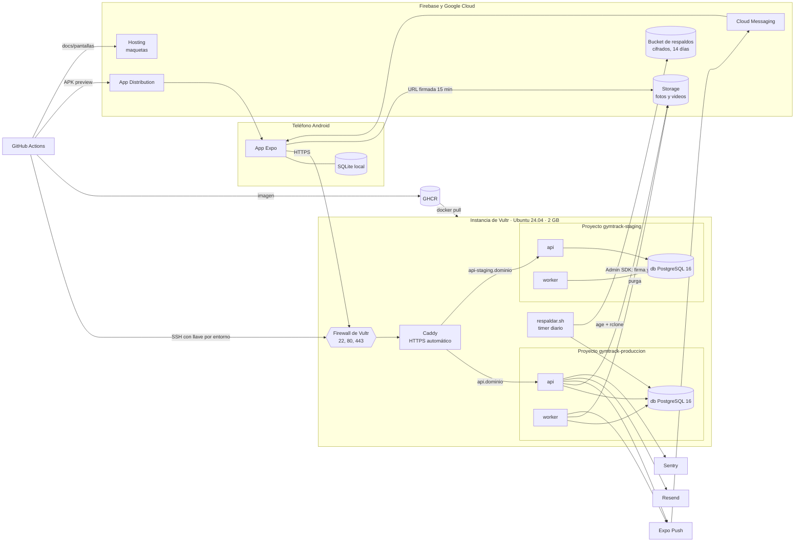

# Infraestructura de GymTrack: VPS en Vultr y Firebase

El PRD ponía todo en Railway (§Arquitectura, fila «Infraestructura»). La decisión ahora es otra: la API, el worker y PostgreSQL van en un VPS propio en **Vultr**, y Firebase se usa para lo que hace mejor que un servidor solo: Cloud Messaging, Storage, App Distribution y Hosting. Este documento dice qué va dónde y por qué, cómo se despliega, cómo se respalda, cómo se protege y cómo se prueba. Los borradores están en [`infra-propuesta/`](infra-propuesta/) y en [`ci-propuesto/`](ci-propuesto/) (`desplegar-vps.yml`, `respaldo-vps.yml`, `distribuir-apk.yml`, `hosting-maquetas.yml`); los escenarios de prueba, en [`escenarios-infra.md`](escenarios-infra.md).

Todo es borrador: no hay servidor, no hay proyecto de Firebase y nada de esto corre todavía.

## Supuestos que tienes que confirmar

El usuario todavía no dio los detalles del servidor. El diseño los usa como variables; si alguno cambia, cambia solo lo que dice la última columna.

| Variable | Supuesto | Si cambia |
| --- | --- | --- |
| Proveedor | Vultr, Cloud Compute | Solo cambian el firewall de la nube, los respaldos de la instancia, la IP reservada y los secretos `VULTR_*` (ver «Qué es de Vultr y qué no») |
| Ubicación de la instancia | Santiago, Chile (no verificado que Vultr la ofrezca para tu plan; confírmalo en el panel) | Si queda en otro país, sube la latencia y cambia el análisis de transferencia internacional de datos (Ley 21.719) |
| Sistema | Ubuntu 24.04 LTS | Los comandos de `apt`, `ufw` y `unattended-upgrades` |
| Tamaño | 2 GB de RAM, 2 vCPU, disco SSD de unos 55 a 65 GB (no verificado) | El presupuesto de memoria de «Servicios de Compose» |
| Contenedores | Docker Engine y el plugin Docker Compose v2 | Nada, si es Compose v2 |
| Acceso | SSH con llave, sin contraseña | Nada |
| Dominio | Propio, con `api.<dominio>` y `api-staging.<dominio>` apuntando a la IP de la instancia | El Caddyfile y las variables `*_API_URL` |
| Repositorio | Privado en GitHub, con GHCR para las imágenes | Si es público, GHCR no cobra y la imagen puede ser pública |
| Proyectos de Firebase | Dos: `<proyecto-staging>` y `<proyecto-produccion>`, en el plan Blaze | Ver «Firebase» |
| Región de Storage | `southamerica-west1` (Santiago) para fotos y respaldos | Ver «Costos y límites»: solo tres regiones de EE. UU. tienen cuota sin costo |

## Qué cambia frente al PRD

| PRD (Railway) | Ahora | Por qué |
| --- | --- | --- |
| API y worker en servicios de Railway | Contenedores en la instancia de Vultr, con Docker Compose | Es el servidor del usuario; Compose describe los dos entornos en tres archivos |
| PostgreSQL de Railway con respaldo diario | PostgreSQL 16 en un contenedor sin puerto público; `pg_dump` diario cifrado a Cloud Storage, más los respaldos de la instancia de Vultr como segunda capa | El respaldo tiene que vivir fuera del servidor y fuera del proveedor del servidor |
| Bucket S3 de Railway o Cloudflare R2 | Cloud Storage para Firebase, con URLs firmadas V4 desde el Admin SDK | Lo pidió el reparto; las reglas niegan todo acceso directo y el bucket queda en Santiago |
| Cron de Railway para el worker | Worker como proceso largo con su propio programador | Los recordatorios corren cada pocos minutos, no solo de noche |
| Chequeo de salud y reinicio de Railway | `restart: unless-stopped`, healthcheck de Docker, Caddy y un monitor externo | §Disponibilidad pide reinicio automático y chequeo de salud |
| Secretos en variables de Railway (§Seguridad) | Archivos `.env` en el servidor (dueño root, permisos 640) y entornos de GitHub | Ningún secreto en el repo ni en la imagen |
| Expo Push «sin Firebase a mano» | Expo Push sigue igual, pero en Android necesita la llave de cuenta de servicio FCM V1 cargada en EAS | Expo usa FCM por debajo; la API no cambia su código de push |

Sin cambios: ingreso con correo, Argon2id y JWT (no Firebase Auth), Resend para los correos (nunca SMTP directo desde el servidor), Sentry, EAS Build y Google Play.

> Cuando el equipo apruebe este cambio, hay que actualizar el PRD en §Arquitectura (diagrama y filas «Almacenamiento», «Tareas programadas» e «Infraestructura»), §Seguridad («Secretos en variables de entorno de Railway»), §Disponibilidad y §Plan (fase 0 y primer sprint: «staging en Railway», «Crear el proyecto de Railway»). Este documento no toca el PRD.

## Qué va dónde y por qué

| Pieza | Dónde | Por qué ahí |
| --- | --- | --- |
| API Fastify | Instancia de Vultr, contenedor `api` por entorno | El curso evalúa el servidor; un proceso Node con Prisma cabe bien en 320 MB |
| Worker | Instancia de Vultr, contenedor `worker` por entorno, misma imagen que la API | Comparte código y migraciones con la API |
| PostgreSQL 16 | Instancia de Vultr, contenedor `db` por entorno, solo en una red interna | Una base por entorno; sin puerto publicado no hay nada que atacar desde afuera |
| HTTPS | Caddy en la instancia, delante de las dos API | Certificados de Let's Encrypt automáticos y renovación sola |
| Fotos de progreso y medios de ejercicios | Cloud Storage para Firebase, un bucket por proyecto | URLs firmadas de 15 minutos sin pasar los archivos por la API; no gasta disco ni ancho de banda del servidor |
| Respaldos de la base | Bucket aparte en Google Cloud, en el proyecto de producción | Fuera del servidor y de Vultr: si se pierde la instancia o la cuenta de Vultr, los respaldos siguen |
| Push | Expo Push, que en Android entrega por FCM | Expo ya lo pedía; FCM no cobra |
| APK de prueba | Firebase App Distribution | Repartir el APK a teléfonos reales antes de la prueba cerrada de Play, sin pasar el archivo por chat |
| Maquetas y web futura | Firebase Hosting | `docs/pantallas` son archivos estáticos; Hosting da HTTPS y vistas previas por PR |
| Correo | Resend | Los proveedores de VPS suelen bloquear el puerto 25 y un VPS nuevo cae en spam |
| Errores | Sentry, entornos `staging` y `produccion` | Igual que el PRD |
| Imágenes | GHCR | Queda junto al repo y GitHub Actions publica con su propio token |

### Diagrama



## Qué es de Vultr y qué no

El servidor es un Ubuntu con Docker. Todo lo de `infra-propuesta/` funciona igual en cualquier proveedor. Lo único atado a Vultr:

| Pieza de Vultr | Para qué | Si te cambias de proveedor |
| --- | --- | --- |
| Firewall Groups | Firewall de red delante de `ufw`: solo 22, 80 y 443 entrantes, en IPv4 y en IPv6 | Usa el firewall de red del otro proveedor; si no tiene, `ufw` queda solo y hay que cuidar más los puertos publicados por Docker |
| Respaldos automáticos de la instancia | Segunda capa, para volver a levantar el servidor entero | El equivalente del otro proveedor, o nada: la primera capa (el `pg_dump` cifrado en Cloud Storage) no depende de Vultr |
| Snapshots | Copia del disco antes de un cambio grande (subir Ubuntu, subir PostgreSQL) | Igual |
| IP reservada (opcional) | Que la IP no cambie si reconstruyes la instancia | Cambias los registros DNS |
| Secretos `VULTR_HOST`, `VULTR_SSH_USER`, `VULTR_SSH_KEY`, `VULTR_SSH_HOST_KEY` | Cómo entra GitHub Actions por SSH | Cambias los valores; si quieres, también el nombre |

El despliegue **no usa la API de Vultr**: solo SSH. No hace falta un token de Vultr en GitHub.

### Plan de Vultr recomendado

Para 2 GB, el plan «Regular Performance» o «High Performance» de Cloud Compute con 2 vCPU y 2 GB (no verificado: Vultr bloquea su página de precios a las consultas automáticas, así que los precios y los nombres de plan los confirmas en el panel). Valores de referencia que hay que revisar: entre 12 y 18 USD al mes por la instancia (no verificado), más el 20 % por los respaldos automáticos (el 20 % sale en la documentación de Vultr; el monto final depende del plan).

Elige 2 vCPU y no 1: la API, dos bases y la compilación de índices compiten por CPU. Si el uso real de RAM pasa de 75 % de forma sostenida (lo avisa `vigilar-recursos.sh`), el siguiente paso es la instancia de 4 GB, no apretar más los límites.

### Firewall de Vultr

Un grupo `gymtrack` asociado a la instancia, con reglas de entrada:

| Protocolo | Puerto | Origen | Para qué |
| --- | --- | --- | --- |
| TCP | 22 | Cualquiera (IPv4 e IPv6) | SSH de GitHub Actions (sus IP cambian) y del equipo. Si después usan una VPN o una IP fija, restríngelo |
| TCP | 80 | Cualquiera | Let's Encrypt y la redirección a https |
| TCP | 443 | Cualquiera | API |
| UDP | 443 | Cualquiera | HTTP/3 de Caddy (opcional; si lo quitas, quita también `443:443/udp` de `compose.borde.yml`) |

Según la documentación de Vultr, un grupo **no se aplica hasta que tiene al menos una regla**, y filtra IPv4 e IPv6 por separado: carga las reglas en las dos pestañas. Por qué dos firewalls: Docker escribe sus propias reglas de iptables y los puertos que publica un contenedor se saltan `ufw`. El firewall de Vultr está fuera de la instancia, así que un `ports:` puesto por error no queda expuesto (INF-11). Que filtre antes de llegar a la instancia está implícito en la documentación pero no dicho con esas palabras (no verificado); INF-11 lo prueba.

### Respaldos de la instancia y snapshots

| | `pg_dump` cifrado (primera capa) | Respaldo automático de Vultr (segunda capa) | Snapshot de Vultr |
| --- | --- | --- | --- |
| Qué guarda | Solo la base de producción, consistente | El sistema de archivos activo de la instancia (incluye los volúmenes de Docker); no incluye Block Storage adjunto | La instancia completa en ese momento |
| Dónde | Cloud Storage, fuera de Vultr | Vultr | Vultr |
| Cuándo | Diario a las 07:00 UTC y antes de cada migración de producción | Diario o semanal, según lo configures (no verificado el detalle de horarios y cuántos guarda) | A mano, antes de cambios grandes |
| Para qué | Recuperar datos, incluso si se pierde la cuenta de Vultr | Volver a levantar el servidor completo rápido | Volver atrás un cambio de sistema |
| Costo | Centavos (ver «Costos») | 20 % del precio de la instancia (Vultr) | Por GB guardado (no verificado) |

La copia de la instancia no reemplaza al `pg_dump`: copia el disco con PostgreSQL andando, y lo que se espera es que PostgreSQL se recupere como después de un corte de luz, pero eso no está garantizado (no verificado si Vultr hace la copia consistente). Restaurarla además sobrescribe la instancia. Sirve para recuperar el servidor; los datos se recuperan del `pg_dump`.

### IP reservada

Conviene si piensan reconstruir la instancia desde un respaldo (el simulacro de INF-20): la IP pasa a la instancia nueva y el DNS no cambia. Si no, basta con DNS con TTL de 300 segundos. Precio no verificado.

### Vultr Object Storage para los respaldos

Es compatible con S3, así que `rclone` lo usa igual que a Cloud Storage: cambia solo `rclone.conf`. Aun así, **la recomendación es Cloud Storage** para los respaldos:

- **Otro proveedor.** Si se suspende o se compromete la cuenta de Vultr, los respaldos están en Google. En Object Storage de Vultr, caen con la cuenta.
- **Permisos finos.** En Google Cloud la cuenta de servicio del servidor puede crear y leer objetos sin poder borrarlos; la retención la hace el ciclo de vida del bucket. Que Vultr permita llaves limitadas a un bucket y reglas de vencimiento no está confirmado en su documentación (no verificado).
- **Costo.** Unos centavos al mes en Cloud Storage para pocos GB; Object Storage de Vultr cobra una tarifa mensual mínima (no verificado el monto).

Object Storage de Vultr sí tiene sentido como **segunda copia** de los respaldos, si algún día quieren dos destinos. Las fotos de la app quedan en Firebase Storage en cualquier caso.

## El servidor

### Carpetas

```
/opt/gymtrack/
  vps.env                      DOMINIO e IMAGEN
  bin/                         desplegar.sh, puerta-ssh.sh, respaldar.sh, restaurar-prueba.sh, vigilar-recursos.sh
  app/                         compose.yml, compose.staging.yml, compose.produccion.yml
  borde/                       compose.borde.yml, Caddyfile, .env
  produccion/                  app.env, db.env, secretos/storage-api.json, .version, .version-anterior
  staging/                     lo mismo, con sus propios valores
/etc/gymtrack/
  respaldo/                    respaldo.env, rclone.conf, sa-respaldos.json, age-destinatario.txt (solo root)
  vigilancia.env
/var/backups/gymtrack/         las 3 últimas copias cifradas por entorno
/var/log/gymtrack/             restauraciones.log
```

### Servicios de Compose

Tres proyectos de Compose separados. Cada entorno tiene su base, su volumen, sus archivos de variables y su subdominio; comparten solo Caddy y la red `borde`.

| Proyecto | Servicio | Imagen | Redes | Memoria | CPU |
| --- | --- | --- | --- | --- | --- |
| `gymtrack-borde` | `caddy` | `caddy:2-alpine` | `borde` | 64 MB | 0,5 |
| `gymtrack-produccion` | `api` | `ghcr.io/<dueño>/gymtrack-api:v1.2.3` | `datos`, `salida`, `borde` (alias `api-produccion`) | 320 MB | 1,0 |
| | `worker` | la misma | `datos`, `salida` | 192 MB | 0,5 |
| | `db` | `postgres:16-alpine` | `datos` | 448 MB | 1,0 |
| `gymtrack-staging` | `api` | `ghcr.io/<dueño>/gymtrack-api:sha-<commit>` | `datos`, `salida`, `borde` (alias `api-staging`) | 224 MB | 0,5 |
| | `worker` | la misma | `datos`, `salida` | 128 MB | 0,25 |
| | `db` | `postgres:16-alpine` | `datos` | 256 MB | 0,5 |
| | | | **Suma de límites** | **1.632 MB** | |

- `datos` es una red `internal`: sin salida a internet. Solo la base, la API y el worker la ven. La base no está en `borde` ni en `salida`, así que ni Caddy llega a ella.
- `borde` es externa y la comparten las dos API con Caddy. Las dos se llaman `api` dentro de su proyecto: en `borde` ese nombre resuelve a las dos. Por eso Caddy usa los alias `api-produccion` y `api-staging`.
- Los límites son techos, no consumo. Lo esperado en reposo es cerca de 900 MB a 1,1 GB en total (no verificado hasta medir). Ubuntu, Docker, sshd y fail2ban usan cerca de 300 MB. Con 2 GB queda poco margen: por eso hay un swap de 2 GB solo para el sistema (`vm.swappiness=10`) y los contenedores tienen `memswap_limit` igual a su límite, para que uno que se pase muera y se reinicie en vez de arrastrar al servidor.
- Staging tiene límites más bajos y se puede apagar entero sin tocar producción. `restaurar-prueba.sh` lo pausa si quedan menos de 450 MB libres.
- La API y el worker corren como el usuario `node`, con el sistema de archivos de solo lectura, sin capacidades y con `no-new-privileges`.

### Tareas programadas del servidor

Con timers de systemd, no con cron, para tener registro en `journalctl` y `Persistent=true` (si el servidor estaba apagado a la hora, corre al prender):

| Timer | Cuándo (UTC) | Qué corre |
| --- | --- | --- |
| `gymtrack-respaldo.timer` | Todos los días 07:00 (04:00 de Chile en verano) | `respaldar.sh produccion diario` |
| `gymtrack-recursos.timer` | Cada 5 minutos | `vigilar-recursos.sh` |
| `gymtrack-semilla-staging.timer` | Domingo 07:30 | Recarga la semilla `staging` (`datos-de-prueba.md`): `docker compose -p gymtrack-staging run --rm --no-deps api <comando de semilla>` (PENDIENTE el comando real). Reemplaza al servicio `semilla-staging` de Railway |

Ejemplo de la pareja de unidades del respaldo:

```ini
# /etc/systemd/system/gymtrack-respaldo.service
[Unit]
Description=Respaldo cifrado de la base de producción
After=docker.service
[Service]
Type=oneshot
ExecStart=/opt/gymtrack/bin/respaldar.sh produccion diario

# /etc/systemd/system/gymtrack-respaldo.timer
[Timer]
OnCalendar=*-*-* 07:00:00 UTC
Persistent=true
RandomizedDelaySec=5m
[Install]
WantedBy=timers.target
```

Staging no se respalda: se recarga con la semilla cada domingo y sus datos son falsos.

## Entornos

| | Local | CI | Staging | Producción |
| --- | --- | --- | --- | --- |
| API y worker | `pnpm --filter api dev` | Contenedor del job con `NODE_ENV=test` | Vultr, proyecto `gymtrack-staging`, imagen `sha-<commit>` | Vultr, proyecto `gymtrack-produccion`, imagen `v1.2.3` |
| URL | `localhost:3000` | `localhost:3000` | `https://api-staging.<dominio>` | `https://api.<dominio>` |
| Base | PostgreSQL 16 en `docker compose` | Servicio PostgreSQL 16 del job | Contenedor `db` de staging | Contenedor `db` de producción, `pg_dump` diario cifrado con 14 días de retención (§Disponibilidad) |
| Archivos | MinIO hoy; emulador de Storage cuando la API use el Admin SDK (P-57) | Igual que local (P-57) | Bucket de Storage de `<proyecto-staging>` | Bucket de Storage de `<proyecto-produccion>`, con versionado |
| Push | Buzón de prueba | Buzón de prueba | Expo Push, por FCM de `<proyecto-staging>`, a los teléfonos del equipo | Expo Push por FCM de `<proyecto-produccion>` |
| App | Expo Go o build de desarrollo | Variante `e2e` | APK `preview` por EAS, repartido por App Distribution | AAB `production` por EAS a Google Play |
| `NODE_ENV` | `development` | `test` | `production` (con `APP_ENTORNO=staging`) | `production` |
| Rutas `/test/*` | Sí | Sí | No, y además Caddy responde 404 | No, y además Caddy responde 404 |

## Variables y secretos

### En el servidor

Formato completo en [`infra-propuesta/env.ejemplo`](infra-propuesta/env.ejemplo). Ningún valor real va en el repo ni en la imagen.

| Archivo | Qué trae | Permisos |
| --- | --- | --- |
| `/opt/gymtrack/vps.env` | `DOMINIO`, `IMAGEN` | root:despliegue 640 |
| `/opt/gymtrack/<entorno>/db.env` | `POSTGRES_USER`, `POSTGRES_PASSWORD`, `POSTGRES_DB` | root:despliegue 640 |
| `/opt/gymtrack/<entorno>/app.env` | `DATABASE_URL`, `JWT_SECRET`, `JWT_REFRESH_SECRET`, `RESEND_API_KEY`, `CORREO_REMITENTE`, `EXPO_ACCESS_TOKEN`, `SENTRY_DSN`, `SENTRY_ENVIRONMENT`, `FIREBASE_PROJECT_ID`, `STORAGE_BUCKET`, `URL_FIRMADA_MINUTOS`, umbrales de detección (P-34), `HC_WORKER_URL` | root:despliegue 640 |
| `/opt/gymtrack/<entorno>/secretos/storage-api.json` | Llave de la cuenta de servicio `api-medios` de ese proyecto | root:despliegue 640, montada de solo lectura |
| `/etc/gymtrack/respaldo/*` | Llave de `vps-respaldos`, `rclone.conf`, llave pública de age, URL de Healthchecks.io | root 600 |
| `/etc/gymtrack/vigilancia.env` | URL de Healthchecks.io y umbrales | root 600 |

`VERSION` no va en ningún archivo: la pone `desplegar.sh` al llamar a Compose y queda anotada en `.version`.

### En GitHub

| Nombre | Tipo | Dónde | Lo usa |
| --- | --- | --- | --- |
| `VULTR_HOST` | Variable | Repositorio | `desplegar-vps.yml`, `respaldo-vps.yml` |
| `VULTR_SSH_USER` | Variable (`despliegue`) | Repositorio | Los mismos |
| `VULTR_SSH_HOST_KEY` | Variable (la llave pública del host, `ssh-ed25519 AAAA...`) | Repositorio | Los mismos, para `known_hosts` |
| `VULTR_SSH_KEY` | Secreto | Entornos `staging`, `produccion` y `respaldo`, **una llave distinta en cada uno** | Cada llave solo abre lo de su alcance en `puerta-ssh.sh` |
| `AGE_CLAVE_PRIVADA` | Secreto | Entorno `respaldo` | `respaldo-vps.yml`, restauración de prueba |
| `IMAGEN_API` | Variable (`ghcr.io/<dueño>/gymtrack-api`) | Repositorio | `desplegar-vps.yml` |
| `STAGING_API_URL`, `PRODUCCION_API_URL` | Variables | Entornos `staging` y `produccion` (ya estaban) | Humo y revisión desde afuera |
| `HUMO_CLAVE`, `HUMO_CLAVE_PRODUCCION` | Secretos (ya estaban) | Entornos `staging` y `produccion` | Humo |
| `EXPO_TOKEN` | Secreto (ya estaba) | Entornos `staging` y `produccion` | `distribuir-apk.yml`, `version.yml` |
| `GCP_WIF_PROVEEDOR_STAGING` | Variable | Repositorio | `distribuir-apk.yml`, `hosting-maquetas.yml` |
| `GCP_SA_DISTRIBUCION`, `GCP_SA_HOSTING` | Variables (correo de la cuenta de servicio) | Repositorio | Los mismos |
| `FIREBASE_APP_ID_ANDROID_STAGING` | Variable | Repositorio | `distribuir-apk.yml` |
| `MAQUETAS_URL` | Variable | Repositorio | `hosting-maquetas.yml` |

Se borran `RAILWAY_TOKEN_STAGING` y `RAILWAY_TOKEN_PRODUCCION`. Las imágenes se publican y se bajan con el `GITHUB_TOKEN` de cada job: no hay token de GHCR guardado en el servidor ni en GitHub.

### Entornos de GitHub

| Entorno | Protección | Por qué |
| --- | --- | --- |
| `staging` | Solo la rama `main` | Cada push a `main` despliega |
| `produccion` | Revisores: una persona de cada frente; **Prevent self-review** activado; solo etiquetas `v*.*.*` | En GitHub basta **una** aprobación de la lista (documentación de GitHub). Con «Prevent self-review», quien empujó la etiqueta no puede aprobar su propio despliegue |
| `respaldo` | Solo la rama `main`, sin revisores | Las corridas programadas no pueden esperar aprobación |

### En EAS y en Firebase

| Qué | Dónde | Notas |
| --- | --- | --- |
| Llave de cuenta de servicio FCM V1 de cada proyecto | Credenciales de EAS, por paquete de Android | `eas credentials` > Android > Google Service Account > «Manage your Google Service Account Key for Push Notifications (FCM V1)». La cuenta necesita el rol «Firebase Cloud Messaging API Admin» (documentación de Expo) |
| `google-services.json` de cada proyecto | Variable de archivo de EAS (`GOOGLE_SERVICES_JSON`) y `android.googleServicesFile` en la configuración de la app | Expo dice que este archivo se puede commitear; igual conviene tenerlo como variable para cambiar entre staging y producción por perfil |
| Cuenta de servicio de Google Play | EAS (ya estaba) | Igual que antes |

### Cuentas de servicio de Google Cloud

| Cuenta | Proyecto | Roles | La usa |
| --- | --- | --- | --- |
| `api-medios` | Cada uno | `Storage Object Admin` **solo sobre el bucket de medios** de ese proyecto | API (firma URLs, confirma subidas) y worker (purga) |
| `vps-respaldos` | Producción | `Storage Object Creator` y `Storage Object Viewer` solo sobre el bucket de respaldos. Sin permiso para borrar | `respaldar.sh` y `restaurar-prueba.sh`. Si el servidor cae en malas manos, no puede borrar ni sobrescribir respaldos |
| `fcm-expo` | Cada uno | `Firebase Cloud Messaging API Admin` | Expo Push (la llave va en EAS) |
| `gh-distribucion` | Staging | `Firebase App Distribution Admin` | `distribuir-apk.yml`, por Workload Identity Federation |
| `gh-hosting` | Staging | `Firebase Hosting Admin` | `hosting-maquetas.yml`, por Workload Identity Federation |

## Despliegue

### Staging, en cada push a `main`

`staging.yml` llama a `desplegar-vps.yml` con `entorno: staging` y `version: sha-<commit>`:

1. **`imagen`.** Construye `apps/api/Dockerfile` (el mismo de `api-build` en `api.yml`) y lo publica en GHCR como `sha-<commit>`, con la caché de capas de GitHub. El commit queda dentro de la imagen (`build-arg COMMIT`), y `/health` responde `{"estado":"ok","version":"sha-<commit>","commit":"<commit>"}` (PENDIENTE en la API): `desplegar.sh` revisa la versión y `version.yml` revisa el commit.
2. **`desplegar`**, entorno `staging`. Entra por SSH como `despliegue` con la llave de staging. En el servidor, `puerta-ssh.sh` acepta solo `desplegar staging <version>` y llama a `desplegar.sh`, que:
   1. baja la imagen con el `GITHUB_TOKEN` del job, que llega por stdin, sirve solo para leer paquetes y vence con el job;
   2. levanta la base si no estaba;
   3. corre `npx prisma migrate deploy` con la imagen nueva (`docker compose run --rm`). Si falla, termina con error y la versión anterior sigue atendiendo;
   4. levanta la API y el worker con la versión nueva. Caddy aguanta hasta 15 s las peticiones mientras se recrea el contenedor;
   5. espera hasta 2 minutos a que `/health`, pedido por Caddy con el certificado real, responda 200 **con la versión nueva**;
   6. si no responde, vuelve solo a la versión anterior y termina con error.
3. Desde GitHub: `/health` por internet con la versión, `http://` redirige con 308 (SEG-022), `/test/reset` da 404 (SEG-025) y el humo de siempre (`humo:staging`). Si el humo falla, pide `volver staging` y abre un issue `staging-roto`.

La app de prueba sale aparte, en `distribuir-apk.yml` (ver «App Distribution»).

### Producción, con una etiqueta

Empujar `v1.2.3` dispara `version.yml`, que ya tiene el orden: `comprobar` (la etiqueta está en `main` y staging corre ese mismo commit), `suite-completa`, `fotos-staging` y luego `produccion`, que ahora llama a `desplegar-vps.yml` como workflow reutilizable:

1. **`promover`.** No recompila: pone la etiqueta `v1.2.3` a la imagen `sha-<commit>` que ya corrió en staging. Mismo digest, mismo código.
2. **`desplegar`**, entorno `produccion`. Espera la aprobación. Después, lo mismo que en staging, con dos diferencias: `desplegar.sh` toma un respaldo `predespliegue` antes de migrar, y a producción solo entran versiones `v*`.
3. Humo de solo lectura (`humo:produccion`). Si falla, vuelve atrás y abre `produccion-rota`.
4. Después siguen `play-interna` y `release` de `version.yml`, como antes.

### Vuelta atrás

| Caso | Qué pasa |
| --- | --- |
| La migración falla | No se cambia de versión. Prisma deja la migración fallida anotada en `_prisma_migrations`: arregla la migración en un PR nuevo y, antes de volver a desplegar, márcala con `prisma migrate resolve --rolled-back <nombre>` (dentro del contenedor, con `docker compose run --rm api npx prisma migrate resolve ...`) |
| `/health` no responde con la versión nueva | `desplegar.sh` vuelve solo a la anterior y el job falla |
| El humo falla | El workflow pide `volver <entorno>` |
| Algo se rompe después | `workflow_dispatch` de `desplegar-vps.yml` con `accion: volver`. Vuelve a `.version-anterior`, que sigue en el servidor (`desplegar.sh` no borra las imágenes en uso ni la anterior de cada entorno) |
| Una migración destructiva rompió datos | Volver el código no basta. Se restaura el respaldo `predespliegue` de esa versión en una base temporal y se recuperan los datos a mano; por eso ci.md pide hacer los cambios que borran o renombran en dos versiones |

Volver atrás cambia el código, no el esquema. Funciona porque cada migración es compatible con la versión anterior del código (ci.md, «Migraciones de Prisma»).

### Primera instalación

Una sola vez, a mano, con una persona del equipo:

1. Crear la instancia en Vultr (Ubuntu 24.04, 2 vCPU, 2 GB, ubicación Santiago si existe para el plan), con tu llave SSH. Activar los respaldos automáticos. Opcional: IP reservada.
2. Crear y asociar el firewall `gymtrack` con las reglas de arriba, en IPv4 y en IPv6.
3. Apuntar `api` y `api-staging` del dominio a la IP (registros A y, si hay IPv6, AAAA).
4. Endurecer el servidor (siguiente sección) y crear los usuarios: uno personal con `sudo` por cada persona que administra, y `despliegue` (en el grupo `docker`, sin `sudo` salvo los dos scripts de respaldo).
5. Instalar Docker Engine y el plugin de Compose desde el repositorio oficial de Docker, más `age`, `rclone` y `fail2ban` de Ubuntu.
6. Copiar `infra-propuesta/` a `/opt/gymtrack/` según «Carpetas», crear los archivos de variables y la red: `docker network create borde`.
7. Levantar Caddy y comprobar que saca los certificados.
8. Crear los proyectos de Firebase, los buckets y las cuentas de servicio (sección «Firebase»).
9. Cargar las llaves de `despliegue` en `authorized_keys` con el comando forzado, y los secretos y variables en GitHub.
10. Correr `desplegar-vps.yml` a mano en staging y después hacer la primera restauración de prueba.

## Respaldos

| Qué | Cómo |
| --- | --- |
| Frecuencia | Diario a las 07:00 UTC (`gymtrack-respaldo.timer`), más uno `predespliegue` antes de cada migración de producción |
| Formato | `pg_dump --format=custom`, corrido dentro del contenedor `db` (misma versión que el servidor, sin abrir el puerto) |
| Cifrado | `age` con la llave pública en el servidor. La privada vive en el entorno `respaldo` de GitHub y en el gestor de claves del equipo; el servidor puede cifrar pero no descifrar |
| Destino | `gs://<proyecto-produccion>-respaldos/produccion/{diario,predespliegue}/`, en `southamerica-west1`, con `rclone copyto --immutable` |
| Retención | 14 días (§Disponibilidad), con una regla de ciclo de vida del bucket que borra objetos de más de 14 días. El servidor no puede borrar |
| Copias locales | Las 3 más nuevas en `/var/backups/gymtrack/produccion`, para restaurar rápido sin bajar nada |
| Bucket | Acceso uniforme, prevención de acceso público forzada, sin versionado (los objetos no se reemplazan) |
| Aviso | Latido a Healthchecks.io al terminar; `/fail` si falla. Si no llega en 2 horas, Healthchecks.io avisa por correo |
| Revisión | `respaldo-vps.yml`, todos los días a las 11:30 UTC: el diario existe, tiene menos de 26 horas y pesa más de `MINIMO_BYTES` |
| Restauración de prueba | `respaldo-vps.yml`, los lunes: `restaurar-prueba.sh` baja el último diario **desde Cloud Storage**, lo descifra con la llave que llega por stdin y lo restaura en un PostgreSQL temporal sin red y con 256 MB; cuenta filas por tabla, compara con producción, mide la duración y borra todo. Queda anotado en el resumen del job, en un artefacto de 90 días y en `/var/log/gymtrack/restauraciones.log` (MAN-024) |
| Segunda capa | Respaldos automáticos de la instancia de Vultr, para volver a levantar el servidor entero |
| Simulacro | Una vez por semestre: instancia nueva desde cero con la «Primera instalación» y el último respaldo (INF-20) |

**Objetivos.** Pérdida máxima de datos (RPO): 24 horas, por el respaldo diario. Para el piloto alcanza, y la cola sin señal de la app reduce el daño: lo que un teléfono no alcanzó a sincronizar sigue en el teléfono. Si se quiere bajar, el siguiente paso es un respaldo cada 6 horas (la base es chica) o el archivado continuo de WAL con `wal-g`. Tiempo de recuperación (RTO): 30 minutos si solo se cae la base, 4 horas si hay que levantar una instancia nueva (INF-20 lo mide).

## Seguridad del servidor

| Control | Cómo |
| --- | --- |
| Firewall de red | Firewall Groups de Vultr: solo 22, 80 y 443 entrantes (ver arriba) |
| Firewall local | `ufw default deny incoming`, `ufw default allow outgoing`, `ufw limit 22/tcp`, `ufw allow 80/tcp`, `ufw allow 443/tcp`, `ufw allow 443/udp`, con `IPV6=yes` |
| Docker y `ufw` | Docker se salta `ufw` con los puertos publicados. Regla: solo Caddy publica puertos. Nunca `ports:` en `db`, `api` ni `worker`. Para entrar a la base desde tu computador, `ssh` y `docker exec`, nunca un puerto |
| SSH | `/etc/ssh/sshd_config.d/10-gymtrack.conf`: `PasswordAuthentication no`, `KbdInteractiveAuthentication no`, `PermitRootLogin no`, `AllowUsers <admins> despliegue`, `MaxAuthTries 3`, `LoginGraceTime 20` |
| Llaves de GitHub | Una por alcance, con `command="/opt/gymtrack/bin/puerta-ssh.sh <alcance>",restrict`. No abren terminal ni reenvían puertos |
| Usuario sin root | `despliegue` no tiene `sudo` salvo `respaldar.sh` y `restaurar-prueba.sh`. Ojo: estar en el grupo `docker` equivale a ser root en el servidor; lo que limita a GitHub es el comando forzado, no el grupo |
| fail2ban | Jaula `sshd` con `backend = systemd`, `maxretry = 5`, `findtime = 10m`, `bantime = 1h` |
| Actualizaciones | `unattended-upgrades` solo con los orígenes de seguridad; `Automatic-Reboot "true"` a las `08:30` UTC (05:30 de Chile en verano). Los contenedores vuelven solos (`restart: unless-stopped`) |
| Postgres | Sin puerto publicado, solo en la red `datos` (interna), una base y un usuario por entorno, clave de 24 bytes al azar |
| Contenedores | Usuario `node`, `read_only`, `cap_drop: ALL`, `no-new-privileges`, límites de memoria y CPU |
| Docker | `/etc/docker/daemon.json`: `{"log-driver": "local", "log-opts": {"max-size": "10m", "max-file": "3"}, "live-restore": true, "no-new-privileges": true}` |
| Logs | Rotación de Docker (arriba) y `SystemMaxUse=200M` en journald. Caddy redacta `Authorization` y `Cookie`; la API no loguea correos, nombres ni medidas (§Seguridad) |
| Reloj | `systemd-timesyncd` activo: los JWT y las URLs firmadas dependen de la hora |
| Swap | Archivo de 2 GB, `vm.swappiness=10`, solo para que el sistema no muera; los contenedores no lo usan |
| Imagen | Sin `.env` ni llaves adentro (INF-37); paquete privado en GHCR |
| Correo | Nada escucha en el puerto 25; los correos salen por la API HTTPS de Resend |

## Monitoreo

| Qué | Cómo | Avisa |
| --- | --- | --- |
| Errores de la API, el worker y la app | Sentry, con `environment` y `release` igual a la versión | Correo de Sentry |
| Salud de la API | Healthcheck de Docker cada 15 s y reinicio automático; `/health` responde 200, o 503 si no hay base (INT-140) | Docker reinicia; si se repite, `vigilar-recursos.sh` |
| Disponibilidad desde afuera | Monitor HTTP externo cada 5 minutos a `https://api.<dominio>/health` y `https://api-staging.<dominio>/health`, con aviso de vencimiento del certificado. UptimeRobot o Better Stack en su plan gratuito (límites no verificados) | Correo al equipo |
| Disco, RAM, swap, contenedores y OOM | `vigilar-recursos.sh` cada 5 minutos, con latido a Healthchecks.io. Umbrales: disco 80 %, RAM 90 %, swap 50 % | Correo; si el servidor se apaga, deja de llegar el latido y también avisa |
| Respaldo diario | Latido de `respaldar.sh` a Healthchecks.io y revisión diaria de `respaldo-vps.yml` | Correo e issue `respaldo` |
| Worker nocturno | Latido opcional del worker al terminar la noche (`HC_WORKER_URL`) | Correo |
| Logs | `docker compose logs`, en JSON (pino y Caddy) | A mano, por ahora |

Healthchecks.io gratis da 20 chequeos (no verificado); aquí se usan 3 o 4.

## Firebase

### Proyectos y apps

| Proyecto | Plan | Tiene |
| --- | --- | --- |
| `<proyecto-staging>` | Blaze, con alerta de presupuesto | App Android `com.gymtrack.app.staging` (propuesta: paquete propio para instalarla junto a la de Play), FCM, bucket de medios de staging, App Distribution con los grupos, Hosting con el sitio `maquetas` |
| `<proyecto-produccion>` | Blaze, con alerta de presupuesto | App Android `com.gymtrack.app`, FCM, bucket de medios de producción, bucket de respaldos, y más adelante el sitio de la web del entrenador |

Por qué dos proyectos: staging y producción quedan con llaves, reglas y personas distintas, y las maquetas, que toca más gente, quedan lejos de los datos reales. El plan Blaze es obligatorio para Cloud Storage desde el 3 de febrero de 2026 (documentación de Firebase). Las alertas de presupuesto avisan, pero no cortan el gasto.

### Cloud Messaging

1. En cada proyecto, registrar la app Android con su paquete y bajar `google-services.json`.
2. Crear la cuenta `fcm-expo` con el rol «Firebase Cloud Messaging API Admin», generar su llave JSON y subirla en EAS a las credenciales del paquete correspondiente (FCM V1). La llave no va al repo.
3. En la configuración de la app, `android.googleServicesFile`, distinto por perfil de EAS.
4. Activar «push security» en Expo y dejar `EXPO_ACCESS_TOKEN` en el `app.env` de cada entorno.

Si la llave de API de `google-services.json` está restringida, hay que permitir la API de registro de FCM y la de Firebase Installations, y usar el SHA-1 de la llave de firma de Google Play (documentación de Expo).

### Storage

| Qué | Cómo |
| --- | --- |
| Bucket de medios | Uno por proyecto, en `southamerica-west1` (no verificado que la consola de Firebase ofrezca esa región para el bucket por defecto; si no, se crea en Google Cloud y se agrega a Firebase) |
| Rutas | `fotos/<user_id>/<photo_id>.jpg` y `ejercicios/<exercise_id>/<media_id>.<ext>` |
| Subida | `POST /me/photos` o `POST /exercises/:id/media` devuelven una URL firmada V4 de escritura (`action: 'write'`), con `contentType` fijo y 15 minutos de vida. Para limitar el tamaño, el encabezado firmado `x-goog-content-length-range` (no verificado con URLs firmadas); en cualquier caso, la confirmación revisa tamaño y tipo en los metadatos y borra el objeto si no cumple (videos hasta 50 MB, §Datos) |
| Lectura | URLs firmadas V4 de lectura de 15 minutos (§Seguridad), sin `Cache-Control: public` |
| Firma | Admin SDK con la llave de `api-medios` montada en el contenedor |
| Reglas | [`storage.rules`](infra-propuesta/storage.rules): todo negado. La app no usa el SDK de Storage. Las reglas no cubren al Admin SDK ni a las URLs firmadas: el acceso público se cierra en el bucket |
| Bucket | Acceso uniforme, prevención de acceso público forzada, ningún permiso para `allUsers` ni `allAuthenticatedUsers` |
| Versionado | Activado (§Disponibilidad), con una regla que borra versiones no actuales a los 7 días y la eliminación temporal (soft delete) apagada en este bucket. Así una foto borrada se puede recuperar una semana y la purga de los 30 días se completa a más tardar 7 días después (P-58) |
| CORS | No hace falta para la app Android (no aplica CORS). Se configura cuando exista la web |

### App Distribution

- La app de staging recibe el APK del perfil `preview` de EAS desde `distribuir-apk.yml`.
- Grupos: `equipo` (las cinco personas, recibe cada push a `main` que toca la app), `piloto-entrenadores` y `piloto-alumnos` (se les manda a mano con `workflow_dispatch` cuando una versión está lista para el piloto).
- Las versiones se guardan 150 días y las invitaciones vencen a los 30 días si no se aceptan (documentación de Firebase).
- El APK tiene que estar firmado siempre con la misma llave (la de EAS) para que se instale encima del anterior.
- La prueba cerrada de Google Play (20 personas por 14 días, §Publicación) sigue siendo aparte: App Distribution es para antes.

### Hosting

- Sitio `maquetas` en el proyecto de staging, que sirve `docs/pantallas` tal cual: los HTML, `sistema.css`, `maqueta.js`, `marca/` y `3d/`. No sirve archivos `.md` ni nada fuera de esa carpeta.
- Encabezado `X-Robots-Tag: noindex` en todo: tienen datos falsos, pero no son para buscadores.
- La política de privacidad que §Privacidad pide en una URL propia puede ir en otro sitio de Hosting del proyecto de producción (REQ-68, SEG-029).
- `hosting-maquetas.yml` publica en cada push a `main` que toque `docs/pantallas` y deja una vista previa de 7 días en cada PR del mismo repo.
- La web futura del entrenador va en un sitio aparte del proyecto de producción, cuando exista.

## Costos y límites

| Qué | Costo aproximado al mes | Límites que importan |
| --- | --- | --- |
| Instancia de Vultr, 2 vCPU y 2 GB | 12 a 18 USD (no verificado) | Transferencia incluida según plan (no verificado) |
| Respaldos automáticos de Vultr | 20 % de la instancia: cerca de 2,5 a 3,6 USD (el 20 % es de Vultr; el monto, no verificado) | |
| IP reservada (opcional) | No verificado | |
| Storage de medios en `southamerica-west1` | Centavos: el piloto son 8 personas y unas pocas fotos de 1600 px | **Sin cuota gratis**: la cuota sin costo de los buckets nuevos (5 GB-mes guardados, 100 GB al mes de descarga, 5.000 subidas y 50.000 descargas al mes) es solo para `us-central1`, `us-west1` y `us-east1` (página de precios de Firebase). Precio por GB en Santiago, no verificado |
| Bucket de respaldos | Centavos: 14 respaldos diarios más los de cada versión, de pocos MB cada uno en el piloto | Igual que arriba |
| Cloud Messaging | 0 | Sin costo (página de precios de Firebase) |
| App Distribution | 0 | Sin costo (página de precios de Firebase) |
| Hosting | 0 | 10 GB guardados y 360 MB al día de transferencia sin costo; las maquetas pesan cerca de 1,1 MB |
| GHCR (repo privado) | 0 si cabe en la cuota | La cuota gratuita de GitHub Packages para repos privados es chica y cuenta la transferencia hacia el servidor (no verificado el monto). Mantén la imagen chica (multietapa, `node:22-slim`), con las dependencias en su propia capa, y borra versiones viejas con `actions/delete-package-versions` |
| EAS Build | 0 en el plan gratuito si alcanzan las compilaciones del mes (no verificado el número) | `distribuir-apk.yml` compila solo cuando cambia la app |
| Sentry, Resend, Healthchecks.io, monitor externo | 0 en sus planes gratuitos | Límites no verificados |

Total esperado para el piloto: unos 15 a 22 USD al mes, casi todo la instancia de Vultr (no verificado). Si se prefiere la cuota gratis de Storage, los buckets van en `us-east1`, a costa de más latencia y de que los datos de salud queden en EE. UU.; desde el 1 de diciembre de 2026 rige la Ley 21.719, que regula esa transferencia (P-59).

## Riesgos de tener todo en una sola instancia

| Riesgo | Qué pasa | Mitigación |
| --- | --- | --- |
| Se cae la instancia o el centro de datos | Sin API para todos, en los dos entornos | La app sigue registrando sin señal y sincroniza al volver (§SinSeñal); monitor externo avisa en 5 minutos; respaldo automático de Vultr para levantar otra instancia; IP reservada; simulacro semestral (INF-20) con RTO de 4 horas |
| Se pierde el disco o la cuenta de Vultr | Se pierde la base | `pg_dump` diario cifrado en Google Cloud, fuera de Vultr, que el servidor no puede borrar; restauración de prueba semanal |
| Staging se come la RAM de producción | Producción lenta o caída | Límites de memoria por contenedor, staging con límites más bajos, `memswap_limit`, swap solo para el sistema, aviso de RAM (INF-14) |
| Se llena el disco | La base deja de escribir | Rotación de logs, limpieza de imágenes en cada despliegue, solo 3 copias locales de respaldo, aviso al 80 % (INF-32) |
| Alguien entra al servidor | Ve los dos entornos | Firewall de Vultr y `ufw`, SSH solo con llave, fail2ban, llaves de GitHub con comando forzado, Postgres sin puerto, respaldos que el servidor no puede borrar ni descifrar |
| Un despliegue malo | Producción rota | Staging primero con la misma imagen, aprobación, `/health` con versión, humo y vuelta atrás automática (INF-01 a INF-07) |
| Actualización de Ubuntu o Docker rompe algo | Caída hasta arreglar | Solo parches de seguridad automáticos; snapshot de Vultr antes de cambios grandes |
| Certificados | Si se pierde `caddy_data`, Caddy pide certificados de nuevo y puede chocar con los límites de Let's Encrypt | Volumen persistente; el monitor externo avisa antes del vencimiento |
| Una sola persona sabe operar el servidor | Nadie puede arreglarlo | Este documento, la «Primera instalación» y el simulacro hecho por otra persona cada vez (§Plan: rotar personas) |

El siguiente paso, cuando haya usuarios reales más allá del piloto, es sacar staging a otra instancia chica y dejar la de producción sola.

## Cómo se activa

| Fase (§Plan) | Qué se hace |
| --- | --- |
| 0. Cimientos | «Primera instalación», staging en Vultr, `staging.yml` y `desplegar-vps.yml` con la API que solo tiene `/health`, `hosting-maquetas.yml`. Escenarios INF-01, INF-03, INF-05, INF-08 a INF-13, INF-29, INF-30, INF-33 a INF-35, INF-37, INF-38 |
| 1. Cuentas y perfil | Firebase de staging con FCM, `distribuir-apk.yml`, correo por Resend. INF-27, INF-28, INF-39 |
| 2. Rutinas y sesión | Storage de staging con URLs firmadas. INF-23 a INF-26 |
| 4. Entrenador y alertas | Push real por FCM. INF-21, INF-22 |
| 5. Piloto y publicación | Producción (por `version.yml`), `respaldo-vps.yml`, monitoreo completo. INF-02, INF-04, INF-06, INF-07, INF-14 a INF-20, INF-31, INF-32, INF-36 |

Para activar un borrador: copia `ci-propuesto/<archivo>.yml` a `.github/workflows/`, y `infra-propuesta/` al servidor según «Carpetas» (`firebase.json` y `.firebaserc` a la raíz del repo, `storage.rules` a `infra/firebase/`). Revisa los `PENDIENTE` y abre un PR solo con eso.

## Preguntas abiertas de este cambio

Se suman a las de `plan-de-validacion.md` con los números que siguen a P-56:

- **P-57.** ¿Con qué se emula Cloud Storage en CI y en local? Supuesto: el emulador de Storage de Firebase para subir, leer y borrar con el Admin SDK, más `@firebase/rules-unit-testing` para las reglas. Lo que un emulador no reproduce (que una firma vencida dé 403) se prueba contra el bucket de staging (INF-23, INF-24). Mientras la API no use el Admin SDK, los borradores de CI siguen con MinIO.
- **P-58.** ¿Cuánto puede quedar una foto después de la purga? Supuesto: hasta 7 días como versión no actual del bucket, sin eliminación temporal. Si §Privacidad exige que desaparezca al instante a los 30 días, se apaga el versionado en el bucket de medios y la purga lo dice en la política de privacidad.
- **P-59.** ¿Región de los buckets? Supuesto: `southamerica-west1` (Santiago), por latencia y por la Ley 21.719, aunque no tenga cuota gratis.
- **P-60.** ¿Ubicación de la instancia de Vultr? Supuesto: Santiago. Si no está disponible para el plan, São Paulo.
